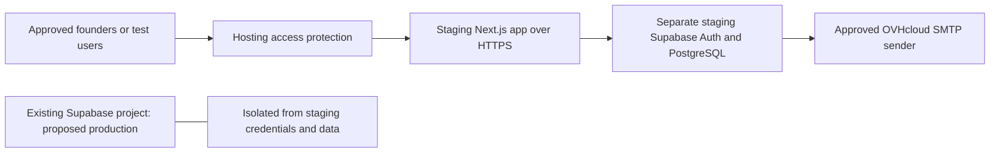

# Stage 3A.1 — remote staging architecture

Planning only, reviewed 27 October 2026. No deployment, purchase, DNS write,
Supabase project/configuration change, invitation or account operation occurred.
Local files containing credentials were not opened or changed. Hosted database
state is taken from the completed [Stage 2E.14 report](./hosted-role-test-cleanup-result.md),
not a fresh database inspection: zero users/profiles/assignments, four migrations,
4 roles / 18 permissions / 31 mappings and six restrictive MFA policies.

## Recommended architecture and account lifecycle

Use **Vercel Pro, a dedicated staging hosting project, and a separate persistent
Supabase staging project** at **https://staging.bewiseinnovation.com**. Retain
OVHcloud DNS and email. Keep the existing project `onfxxtvfprjnqsxdmhkp` isolated
as the proposed eventual production identity/database environment, subject to
the owner's confirmation. Choose an EU application region near the selected
database where supported; confirm latency from founders' locations before launch.



This recommendation follows Supabase's separate-environment migration approach.
It avoids staging code holding production administrative credentials. A
persistent project is simpler here than ephemeral PR branches for stable Auth,
SMTP, factor enrollment and recovery ceremonies. PR previews should be disposable
and receive no persistent-environment privileged keys. [Supabase environments](https://supabase.com/docs/guides/deployment/managing-environments)

**Decide whether onboarding means rehearsal or permanent account activation.**
Separate staging can teach founders the flow using approved test identities,
without production access. Its Auth UUIDs, passwords, sessions, factors and role
assignments do not automatically transfer to another project. Never copy TOTP
seeds or Auth-owned tables to make staging accounts into production accounts.
Real production onboarding requires a new approved invitation, identity check,
MFA enrollment and exact-UUID role binding in the production project.

If the immediate goal is permanent founder accounts, use a separately approved,
stable HTTPS **production onboarding application** backed by the existing project
(for example an owner-approved admin subdomain). The marketing site may remain
unlaunched. That is production identity infrastructure even if called “staging”;
it must not become a shared experimental deployment. Sharing the existing project
with staging saves a database project but couples Auth templates, redirects,
quotas, administrative credentials and account lifecycle. It is not the default
recommendation. Do not silently repurpose a test project or domain after real
accounts have been activated.

## Hosting choices and budget

Prices below are public USD list prices observed during this review, before
tax, usage, exchange charges and optional protection features. Verify the actual
checkout and account entitlements before purchase. Existing subscriptions are
unknown; totals are budgeting examples, not a quote.

| Option | App cost baseline | Maintenance and fit |
| --- | --- | --- |
| **Vercel Pro — recommended** | $20/month platform fee, one deploying seat included; additional deploying seats $20/month each; metered usage/add-ons extra | Most direct fit for this Next.js application; managed HTTPS/builds/rollback. Founders need app accounts, not paid deployer seats. Verify access-protection coverage of the custom domain. |
| Netlify | Personal $9/month; Pro starts at $20/month with unlimited members; credit-based limits | Credible alternative with Next.js integration and secret settings. Validate exact Next.js 16 SSR, proxy, multi-cookie and MFA behavior against its adapter before choosing. Credit exhaustion and build/function usage need monitoring. |
| Render paid Node web service | Official comparison lists an entry 0.5 CPU / 512 MB service at $7/month; confirm current instance and workspace pricing | Standard Node server avoids a framework adapter. More responsibility for sizing, deploy rollback, access gate and proxy/TLS behavior; smallest memory tier is not a performance guarantee. |

Sources: [Vercel Pro costs](https://vercel.com/docs/plans/pro-plan),
[Netlify plans](https://www.netlify.com/pricing/),
[Netlify Next.js integration](https://docs.netlify.com/build/frameworks/framework-setup-guides/nextjs/overview/),
[Render comparison](https://render.com/articles/render-vs-railway),
[Render Next.js deployment](https://render.com/docs/deploy-nextjs-app).

Vercel Hobby is restricted to personal/non-commercial use; do not choose it for
this company staging service. Static-only hosting such as GitHub Pages cannot
run the current server handlers, SSR cookie integration and privileged store
client. A VPS is possible but adds OS patching, process supervision, TLS renewal,
firewall, backup and incident-response ownership without a clear benefit for
four-founder onboarding. [Vercel Hobby terms](https://vercel.com/docs/plans/hobby)

Supabase Pro starts at $25/month with the first project included and additional
projects from $10/month. Free projects may pause after one inactive week and have
limited recovery facilities. For reliable scheduled onboarding, prefer paid
availability and verified backup procedures. If both environments use minimum
paid projects in one Pro organization, budget roughly **$35/month for Supabase**
plus **$20/month for Vercel**, or **$55/month baseline**, before extras. If a Pro
organization is already paid, staging's incremental database cost may start at
$10/month. An eligible free staging project reduces cash cost but needs explicit
acceptance of pauses/recovery limits. Existing OVHcloud domain/mailbox charges
continue; no extra domain purchase is needed. [Supabase pricing](https://supabase.com/pricing)

Set provider usage alerts and owner-approved spend limits. Do not assume a spend
cap covers every compute, add-on or usage item. [Supabase cost controls](https://supabase.com/docs/guides/platform/cost-control)

## Domain, ownership and HTTPS

A read-only DNS lookup during this stage returned nameservers
`dns106.ovh.net` and `ns106.ovh.net` for `bewiseinnovation.com`. The staging CNAME
lookup did not yield a usable result; this does **not** prove the name is free,
unconfigured or controlled by the current Dashboard account. Verify the complete
zone and domain access before any edit.

After separate approval:

1. Add **only** `staging.bewiseinnovation.com` in the staging hosting project's
   domain settings. Use a stable canonical custom hostname, not per-commit URLs.
2. In OVHcloud Control Panel → Web Cloud → DNS zones → `bewiseinnovation.com`,
   review/export the current zone. Add a **CNAME named `staging`** with the exact
   project-specific target supplied by the chosen host. No target value can be
   finalized before that hosting project exists. Do not guess a shared CNAME.
3. Resolve existing conflicting records at that exact label only after review.
   Add the host-specified ownership TXT record only if requested; it proves
   routing/domain control, not staff identity. Retain registrar ownership at OVH.
4. Preserve apex/www routing, nameservers, MX, SPF, DKIM and DMARC records.
   Domain transfer or nameserver migration is unnecessary. Check CAA restrictions
   if certificate issuance fails; do not weaken the entire zone speculatively.
5. Verify authoritative/public DNS, issued certificate hostname and chain,
   renewal status and HTTP-to-HTTPS behavior. HTTPS must work before Auth settings
   or invitations point here. Avoid parent-domain HSTS includeSubDomains changes
   until every affected service has been assessed.

Provider-issued managed HTTPS is preferred; no manually purchased certificate
is proposed. Exact certificate/verification status remains untested until setup.
[Vercel domain setup](https://vercel.com/docs/domains/working-with-domains/add-a-domain),
[OVHcloud subdomain CNAME instructions](https://docs.ovhcloud.com/en/guides/web-cloud/domains/dns-zone-cname-record-creation).

## Reproducing the database and hosted Auth configuration

Use an isolated staging checkout/CI workspace and an explicitly approved new
project reference. Do not relink the operator's existing production-linked
workspace implicitly. Provision no founders through migrations or seeds.

Apply these unchanged version-controlled migrations in order after a separate
target/schema review and dry run:

```text
20261021010000_internal_rbac.sql
20261021010100_seed_internal_roles.sql
20261023010000_auth_flow_security.sql
20261026010000_require_staff_mfa.sql
```

Run the complete local pgTAP, bootstrap, concurrency and Auth integration suites
before that approval. For a new empty staging database the dry run must show
exactly these four files. No automatic schema synchronization, repair, reset,
production restore or user-data import is part of the plan. The database is
PostgreSQL 17-compatible; verify the actual new server version and prerequisites.

After approved application, verify 6 RBAC + 2 security tables, all intended RLS,
6 restrictive MFA policies, 4 roles / 18 permissions / 31 mappings, four history
versions and zero profiles/assignments/Auth users. Inspect function definitions,
restricted search paths and grants. The four store RPCs are in **public** with
service-role execution only; their tables are in **app_private**, which must
remain excluded from Data API exposure. Ordinary caller access uses the genuine
user JWT, never the privileged store client.

Migrations do not reproduce hosted SMTP, URL settings, email templates, password
policy, TOTP configuration, backup entitlement or project keys. Configure and
verify those independently after explicit approval. Do not clone production
secret keys, signing secrets, factor seeds, accounts or private backups into
staging. Do not promise identical UUID values across separate projects.

## Authentication and environment specification

| Setting | Proposed staging value / requirement |
| --- | --- |
| Site URL | `https://staging.bewiseinnovation.com` |
| Redirect allowlist | Exactly `https://staging.bewiseinnovation.com/auth/confirm`; no wildcard previews or arbitrary localhost entries in staging |
| `AUTH_TRUSTED_ORIGIN` | Exactly `https://staging.bewiseinnovation.com`, no trailing slash |
| `NEXT_PUBLIC_SUPABASE_URL` | New staging project's HTTPS URL |
| `NEXT_PUBLIC_SUPABASE_PUBLISHABLE_KEY` | That same staging project's publishable key; intentionally browser-visible |
| `SUPABASE_AUTH_STORE_SECRET_KEY` | Same staging project's server-only secret, entered privately into host secret settings |
| `AUTH_FLOW_SIGNING_SECRET` | New independent cryptographically random secret, at least 32 bytes; stable across staging replicas/deployments |
| `AUTH_RECOVERY_MODE` | `disabled` |
| `AUTH_RECOVERY_TEST_ORIGIN` | Empty; do not enable `hosted-local-test` remotely |
| `AUTH_COOKIE_DIAGNOSTICS` / `AUTH_LOCAL_PREFLIGHT` | `0` / unset; development diagnostics must remain off |
| Runtime/build | Production Next.js server, pinned supported Node LTS compatible with package engines and provider; `npm ci`, `npm run build`; never `next dev` |

Set public values correctly **at build time**; changing only runtime values can
leave a browser bundle pointing at the wrong project. Never promote an artifact
with staging public keys into production. Secret values must not use
NEXT_PUBLIC_, next.config.env, repository files, build output or PR comments.
Only trusted reviewed builds may receive privileged secrets; untrusted forks
and arbitrary previews receive none. Restrict hosting/Dashboard access and keep
provider account MFA separate from application MFA. [Vercel secret configuration](https://vercel.com/docs/environment-variables/sensitive-environment-variables)

Proposed saved template action links (HTML `&amp;` is equivalent):

```text
Invite user:
{{ .SiteURL }}/auth/confirm#token_hash={{ .TokenHash }}&type=invite

Reset password (template prepared; request submission remains disabled):
{{ .SiteURL }}/auth/confirm#token_hash={{ .TokenHash }}&type=recovery
```

Retain Email/password enabled, public signup and anonymous sign-in disabled,
email confirmation enabled, minimum password length 12, and approved TOTP
enrollment/challenge capacity for primary and backup factors. Configure OVHcloud
SMTP privately in the **staging Supabase** Dashboard. Prefer distinct SMTP
credentials/sender identification where the mailbox product supports it. Verify
allowed sender, SPF/DKIM/DMARC alignment, limits, and one approved test mailbox
before founder emails. The app has no need for SMTP passwords. Existing project's
delivery success is evidence of that earlier setup, not proof for a new project.

The fragment is extracted and removed early by the browser, kept only in memory,
and sent only on explicit user POST. GET never verifies the token. Keep no-store,
no-referrer, no analytics/session replay/external assets on sensitive pages.
Host/proxy monitoring must exclude request bodies, cookies and authorization
headers. Legacy query-token URLs may still be logged before application code
executes; reject/avoid them and retain the documented trace safeguards.

The existing strict Origin check already supports configured HTTPS origins. It
compares Origin and Host and rejects conflicting forwarded host/protocol values;
it does not derive trust from X-Forwarded-Host. **Do not loosen it to accommodate
a host.** Test actual provider canonical-host and forwarded-header behavior,
including spoofed/duplicate headers and default deployment aliases, before email
testing. New hosting compatibility is not established by localhost test success.

Flow cookies are HttpOnly, SameSite=Lax, host-only, path `/auth`, 10-minute expiry,
Secure when the route sees HTTPS. SSR session cookies use the SDK adapter and
must be tested on the actual host; do not claim all SDK cookies are HttpOnly.
Confirm request protocol is HTTPS behind the trusted provider, cookie deletion
matches path/domain and all chunks clear, and no parent `.bewiseinnovation.com`
cookie domain is introduced. Keep independent staging/production signing secrets
and host-only cookies. No token-bearing caching/CDN rules may override no-store.

## Minimum deployment and exposure boundaries

Deploy only the current authentication foundation: `/auth/confirm`, password
setup, sign-in/out, MFA page/session handler and stable error/status pages, plus
required static assets. Keep recovery submission disabled. No public registration,
invite-management endpoint, dashboard or business module is needed. MFA enrollment
must remain possible for authenticated unassigned users; a blanket staff-role
gate on these routes would break first-owner bootstrap. Permissioned operations
still require active membership, assigned permission and live AAL2 at server and
database levels. The current proxy refreshes sessions; it is not authorization.

Keep a neutral root status page. Add a reviewed staging host/path access boundary
for non-onboarding paths and future `/internal` routes, plus noindex/nofollow and
robots exclusions; search-engine hints are not access control. The implementation
stage must test direct route access, POST handlers and all deployment aliases.

For the small group, prefer an **outer hosting identity gate** allowing approved
founders/operators, in addition to Supabase. It must cover the canonical custom
domain and generated URLs. Vercel Standard Protection excludes production custom
domains: a dedicated staging project using its “Production” domain is therefore
not automatically private. Verify plan entitlement for All Deployments protection
or explicitly budget a suitable protection method. Do not assume password or
advanced protection is included in Pro. Password Protection is currently listed
as a $20/month/project add-on; it does not replace application MFA/RLS.
[Protection scope](https://vercel.com/docs/deployment-protection),
[protection add-ons](https://vercel.com/docs/plans/pro-plan).

Confirm founders can use the selected host gate without granting deployment or
secret-management privileges. Test a real invitation fragment across the gate's
login redirect using a disposable identity; loss of the fragment is a stopping
condition. Do not embed host bypass tokens in invitation URLs. If an external
gate is declined, approve explicitly the exposure of only minimal public Auth
entrypoints with provider WAF/rate limits; everything else stays denied. A public
URL means internet-reachable, not anonymously privileged.

The sign-in handler already uses durable PostgreSQL quotas through the fixed
store interface. Recovery is disabled remotely by environment/runtime gates.
Shared per-email/global counters can still be exhausted by malicious public
traffic; add provider-level abuse controls before broad exposure. Do not invent
an IP identity from arbitrary forwarded headers or enable recovery merely by
changing NODE_ENV. No new Redis/paid limiter service is required for the current
four-user scope. Monitor auth/quota errors without sensitive payload logging.

## Tooling that must stay private/local

Never launch or expose `auth:hosted:dev`, preflight/cleanup/global-signout helpers,
permission bridges on ports 3011/3012/3013, browser integration runners, database
admin SQL or backup/restore tools as web services, build hooks or public routes.
Keep `scripts/serve-hosted-permission-test.ts`, operator scripts and
`supabase/admin/*` outside the deployed runtime artifact wherever practical.
Tracked reviewable source is not a web endpoint, but it must not be copied into
`public/` or served as a filesystem directory. `.supabase/`, private env files,
backups, `.next/dev/trace`, test logs and credentials must never enter upload
contexts or artifacts. Git ignore alone is insufficient for CLI/Docker uploads;
review `.vercelignore`/container context rules in the implementation stage.

Use a clean checkout and normal production build, not the operator's existing
development directory. No automated `supabase db push`, seed, invitation,
bootstrap, cleanup or secret retrieval is permitted in build scripts. Replace
the hardcoded localhost/project readiness tool with a separately reviewed,
server-only deployment check if needed; do not make it a public endpoint or
relax the existing local runner guards.

## Approval-gated implementation sequence

Each step below is proposed, not executed. Stop on unexpected targets, failed
security checks or ambiguous mutation outcomes; reconcile read-only before retry.

1. **Decisions:** approve rehearsal versus permanent founder accounts, provider,
   budget, project ownership, access gate and DNS hostname. Name operational
   owners and approve recovery governance without assigning invented custodians.
2. **Local implementation only:** pin supported runtime, define host/environment
   separation and production validation, artifact exclusions, access boundary,
   logging policy and provider integration checks. Review code and run existing
   auth, database, bootstrap, concurrency, TypeScript, lint and build checks.
3. **Resource approval:** create the isolated hosting/Supabase staging projects
   and least-privilege Git connection. Disable unreviewed auto-deploys/secret
   injection. Record new project ID; leave the existing linked project unchanged.
4. **Database approval:** inspect new target, establish scoped backup/recovery
   plan, dry-run exactly four migrations, then apply only after explicit approval.
   Verify policies, grants, counts, version history and zero accounts.
5. **Configuration approval:** privately enter same-project secrets, independent
   signing secret, HTTPS trusted origin and recovery-disabled settings. Configure
   staging Auth, fragment templates and SMTP only under that approved scope.
6. **Hosting/DNS approval:** deploy a reviewed commit behind the chosen access
   gate; add only required staging CNAME/TXT entries in OVHcloud; verify HTTPS and
   canonical origin. Ensure preview/default aliases cannot bypass protection.
7. **No-email acceptance:** check real-host Origin/CSRF rejection, GET token
   non-consumption with dummy fragments, no caching/leaks, empty-session denial,
   store readiness privately, restricted RPCs and cookie security. Check no
   privileged key in client assets or logs. Stop before invitations on failure.
8. **Disposable-test approval:** one verified owner-controlled mailbox and one
   invitation; test remote-browser password setup, real TOTP, backup authenticator
   where independently available, AAL1 denial, AAL2 unassigned denial and sign-out.
   Role-positive tests and cleanup need their own exact-UUID scopes. Preserve
   sanitized audit evidence and verify cleanup before founder use.
9. **Founder approval:** independently verify each actual email. For permanent
   accounts use the explicitly approved production identity environment. Invite
   owner first, set password, enroll/verify primary and backup factors, confirm
   live AAL2, review exact-UUID/email bootstrap and execute only with separate
   role-binding approval. Then invite remaining founders and bind only confirmed
   roles after their own MFA readiness. No automatic first-signup owner grant.
10. **Operations:** verify emergency approval/custodian process, account-change
    audit/notifications, session revocation, private backup restoration and secret
    rotation runbooks. Keep public recovery off until separately approved and
    tested on the final remote architecture. Public website launch is a later step.

## Rollback and recovery

Record approved commit, deployment ID, environment mapping, DNS records/TTL and
Auth setting snapshot privately before changes. Retain a known-good production
artifact for the **same** environment. Host rollback must not switch database
projects or reuse a bundle with another project's public key. Pause invitations
and gate access during incidents; never send retries automatically after an
uncertain result. Roll back code only to a security-compatible build, preserving
signing secret and quota continuity. If secrets leaked, use an explicit incident
rotation/revocation plan rather than silently restoring compromised values.

For DNS rollback restore only the exact previous staging records. Detach the
CNAME before deleting a hosting project to avoid a dangling hostname. Preserve
mail and apex records. Changing Site URL does not rewrite already delivered
emails; stop sending, decide whether old links need expiry/reissue and keep
their expected route safe during transition. Do not bounce a real production
account between staging and production projects as a rollback.

Prefer reviewed forward fixes for database problems. Never undo RLS/MFA to regain
convenience, reset a remote database or delete accounts as an automatic rollback.
Use the established private schema/data/roles logical backup and isolated
PostgreSQL 17 restore verification before future database changes. Logical
backups do not restore all hosted Auth/SMTP/URL configuration, Storage object
bytes, service settings or all ongoing sessions. Backup plans, PITR entitlement
and restoration targets must be verified separately; none is assumed here.

## Readiness and decisions requested

The architecture is ready for review; **deployment is not approved or proven**.
No provider account/project or DNS ownership challenge was configured/tested.
Only public documentation and bounded public DNS were consulted remotely.
No hosted database/Auth API inspection was needed in this planning stage.

The next decision is whether to approve **isolated staging rehearsals with a
separate Supabase project** or **a production onboarding service for permanent
founder identities**. Also approve Vercel Pro versus an alternative, monthly
budget including database/protection costs, canonical hostname, access gate,
responsible operators and recovery governance. Actual creation, DNS, Auth
configuration, deployment, emails and role binding remain separate scopes.

Only this document was added. No application code/environment/migration changed;
tests/builds were not rerun for a planning-only Markdown change. The repository
was clean at review start; existing Stage 2E test outcomes are historical evidence,
not claims of remote-staging tests having passed.
